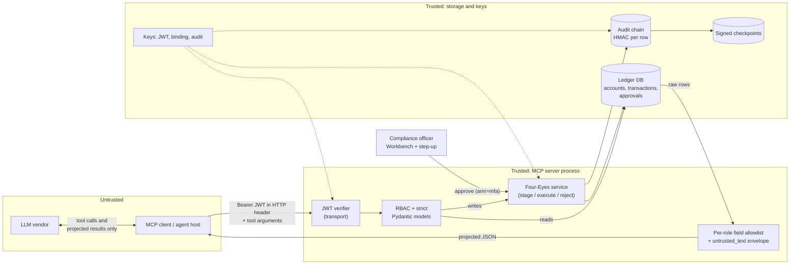

# Fintech Compliance MCP

An MCP server that lets an AI agent investigate financial accounts without trusting the agent. The agent can read data in its own tenant, cut down to what its role may see. It can propose an account freeze or a refund. It cannot carry out either one: a human compliance officer, with step-up authentication, must approve first. Every decision is written to an HMAC-keyed, append-only audit ledger.

This is a **reference implementation**. It has not been certified or audited by a third party. The demo runtime is SQLite; the Postgres row-level-security schema has been tested against a live database, but the data-access layer has not been ported to it yet (see [Known gaps](#known-gaps-and-production-roadmap)).

**Verified on 2026-11-24 (Python 3.14.6):** 127 passed, 8 skipped (7 live-Postgres + 1 live-Stripe, which need credentials). All 29 adversarial tests pass. The live Postgres 17.12 RLS suite passes 21/21. `ruff` and `mypy --strict` are clean.

Showcase site: <https://beingstoic1.github.io/fintech-compliance-mcp/>

---

## What it does, in one table

| Tool | Who may call it | What happens |
|---|---|---|
| `get_account_profile` | all roles | Returns one account from the caller's tenant. Junior analysts see `A. S.`, `****4821` and a masked tax ID. |
| `query_transactions` | all roles | Up to 100 rows. The free-text `memo` comes back verbatim inside an `untrusted_text` envelope. |
| `detect_structuring_anomalies` | all roles | Finds sub-threshold transfer rings in the caller's tenant. |
| `request_account_freeze` | senior investigator | Stages a 15-minute approval. Changes nothing. |
| `request_fee_refund` | senior investigator | Stages a 15-minute approval after checking the amount against the refundable balance. Moves no money. |
| `execute_approved_action` | compliance officer | Runs an action that a *different* human officer already approved with step-up auth. Runs once. |
| `reject_approved_action` | compliance officer | Cancels a pending or approved request. |

There is no `approve` tool. Approval happens only in the Streamlit Risk Workbench, and it needs a token whose `amr` claim shows step-up (`mfa`, `hwk`, `otp`, `swk` or `fido`). Agent tokens carry `amr=pwd`, so an agent cannot approve its own request.

---

## Data flow and trust boundaries



**Trust rules.** The model and the client host are untrusted. The caller's identity, role and tenant come only from the verified bearer JWT, never from tool arguments. Every tool input model uses `extra='forbid'`, and the SDK drops unknown top-level keys, so an injected `tenant_id` or `role` is rejected or ignored (tests T12).

**What never reaches the LLM vendor:**

- Signing and HMAC keys, and the bearer JWT itself. The token travels in an HTTP header that the client host sets; it is never a tool argument or a tool result. The host must keep it out of the prompt.
- Audit-ledger rows, checkpoints, approval HMAC bindings and stored approval arguments.
- Database columns outside each tool's allowlist (`src/domain/policy.py`). A new column stays hidden until someone adds it to the list.
- Tables no tool reads: KYC records and compliance alerts.
- For **junior analysts**: full holder names, account numbers and tax IDs (masked to initials, `****last4`, and a masked tax ID), plus regex-detected PII inside memos.
- Other tenants' data. A cross-tenant lookup returns the same `NOT_FOUND` as a missing record.

**What does reach the LLM vendor:** allowlisted fields for the caller's role. For `senior_investigator` and `compliance_officer`, that includes **unmasked** holder names, account numbers and tax IDs. Run the agent as `junior_analyst` if PII must not leave your boundary. Tool descriptions and schemas are also sent; the maintainer-facing threat-model docstrings are kept out of them (`_MODEL_FACING` in `src/mcp_server/server.py`, checked by `tests/test_threat_model_docs.py`).

---

## Adversarial red-team matrix

29 tests in `tests/adversarial/`. Each one checks three things: the response, the database side effect, and the audit row. Verified passing on 2026-11-24.

| File | Tests | Attacks covered | Defence that holds |
|---|---:|---|---|
| `test_tenant_and_race.py` | 2 | Refund another tenant's transaction (at request time and via a planted approval); 8 threads executing one approval at once | `NOT_FOUND`, zero victim rows; exactly 1 `EXECUTED`, 1 refund row, 7 blocks |
| `test_identity_and_boundary.py` | 6 | `alg=none`, attacker key, HS512 swap, expired / not-yet-valid / over-1-hour tokens, wrong `aud`, legacy tokens; identity fields injected into arguments; `limit` of -1, 0, 101, 10 000, `True`, `"10"`, 1.5; refund of -1, 0, bool, float, original+1, cumulative over-refund, refund-of-refund | Generic `UNAUTHENTICATED` with no token text in the audit row; `extra_forbidden`; never more than 100 rows; refund rule codes, total refunded never above the original |
| `test_four_eyes_state.py` | 9 | Other-tenant officer executes or rejects; NULL / empty tenant approvals; execution 1 µs before and exactly at expiry; stale reads after TTL; reviving REJECTED / EXPIRED / CONSUMED rows; forged APPROVED inserts; idempotency-key reuse and an 8-thread staging race | `Approval not found`; `NOT NULL` failure; SQL compare-and-swap refuses expired approvals; `ILLEGAL_APPROVAL_TRANSITION`, `APPROVAL_ROW_IMMUTABLE`, `ILLEGAL_APPROVAL_INSERT`; one row and one effect per key |
| `test_ledger_tamper.py` | 10 | UPDATE of each of the 12 audit columns, DELETE, `INSERT OR REPLACE`; writes to the v1 archive; re-chaining with an attacker key or unkeyed SHA-256; forged checkpoints; full table wipe | `AUDIT_LOG_APPEND_ONLY`; `ENTRY_HMAC_MISMATCH` / `UNKNOWN_KEY_ID`; `CHECKPOINT_FORGED`; `TRUNCATION_DETECTED`, `GENESIS_MISMATCH` |
| `test_injection_and_pii.py` | 2 | 9 injection memos (English paraphrase, Hindi, Spanish, Chinese, Arabic, base64, RTL override, zero-width split, Cyrillic homoglyph); PAN / account / tax ID / card numbers pushed into reasons, IDs and detail fields | Memo returned byte-for-byte to all roles while the agent's freeze stays PENDING; a sweep of every audit row, `audit_meta` and checkpoint line finds no PII |

The injection test passes because the memo is never trusted, not because it is detected: at least 5 of the 9 memos raise no detection signal. Containment is structural: reads cannot mutate, and every mutation needs a human with step-up auth.

Full suite: 127 tests, grouped as unit and service tests, the adversarial suite above, 14 static Postgres policy checks, 7 live Postgres RLS tests, Stripe adapter contract tests, a lint rule that fails on any `float` in `src/domain/`, and one Streamlit smoke test.

---

## Quickstart

Requires Python 3.11+ (CI targets 3.11; verified locally on 3.14) on macOS or Linux.

```bash
git clone https://github.com/Beingstoic1/fintech-compliance-mcp.git
cd fintech-compliance-mcp
python3 -m venv .venv
.venv/bin/pip install -e '.[dev]'
```

### 1. MCP server over Streamable-HTTP with the dev JWT issuer

Generate one shared secret and start the server with it (binds `127.0.0.1:8000`; the endpoint is `/mcp`):

```bash
export FINTECH_JWT_SECRET="$(.venv/bin/python -c 'import secrets; print(secrets.token_urlsafe(48))')"
```

```bash
FINTECH_MCP_TRANSPORT=streamable-http PYTHONPATH=. .venv/bin/python src/mcp_server/server.py
```

In a second shell, with the same `FINTECH_JWT_SECRET` exported, mint a 15-minute dev token for a demo user (`junior_alice`, `senior_carol`, `officer_eve`, and their `tenant_b2b_cards` counterparts `junior_bob`, `senior_dave`, `officer_frank`):

```bash
TOKEN=$(PYTHONPATH=. .venv/bin/python -c "from src.security.identity import issue_demo_token; print(issue_demo_token('junior_alice'))")
```

Call a tool:

```bash
TOKEN="$TOKEN" .venv/bin/python - <<'EOF'
import asyncio, os
from mcp import ClientSession
from mcp.client.streamable_http import create_mcp_http_client, streamable_http_client

async def main():
    headers = {"Authorization": f"Bearer {os.environ['TOKEN']}"}
    async with create_mcp_http_client(headers=headers) as http:
        async with streamable_http_client("http://127.0.0.1:8000/mcp", http_client=http) as (r, w, *_):
            async with ClientSession(r, w) as s:
                await s.initialize()
                res = await s.call_tool("get_account_profile", {"account_id": "ACC-001"})
                print(res.content[0].text)

asyncio.run(main())
EOF
```

Expected: a request without a bearer gets HTTP 401; `junior_alice` gets `"decision": "REDACT"` with masked fields; `senior_carol` gets `"decision": "ALLOW"`. The dev issuer is for local use only. In production, tokens come from your IdP (set `FINTECH_JWT_ALGORITHM=RS256` or `ES256` and `FINTECH_JWT_PUBLIC_KEY`).

For **stdio** clients, set `FINTECH_JWT_SECRET` and `FINTECH_STDIO_BEARER_TOKEN` (a token minted as above) in the client's `env` block. Without them, every call returns `UNAUTHENTICATED`. Token lifetime is capped at one hour, so re-mint the stdio token when it expires.

### 2. Streamlit Risk Workbench

```bash
PYTHONPATH=. .venv/bin/streamlit run src/workbench/app.py
```

Four tabs: run tools as each demo role, the tenant-scoped Four-Eyes approval queue (approve with simulated step-up, then execute), the audit-ledger verifier with a tamper lab (disabled when `FINTECH_ENV=production`), and operational telemetry (p50/p95 latency, blocked calls by reason, approval turnaround).

### 3. Live Postgres 17 RLS test suite

The test database name must contain `test`; the fixture drops and recreates the `fintech` schema, and the DSN must be a superuser because the migration creates roles.

```bash
.venv/bin/pip install -e '.[postgres]'
```

```bash
export LC_ALL=en_US.UTF-8 PGDATA="$(mktemp -d)/pg"
initdb -D "$PGDATA" -U postgres -A trust
pg_ctl -D "$PGDATA" -o "-p 55432 -c listen_addresses=127.0.0.1" -l "$PGDATA.log" -w start
createdb -h 127.0.0.1 -p 55432 -U postgres fintech_test
```

```bash
FINTECH_PG_TEST_DSN=postgresql://postgres@127.0.0.1:55432/fintech_test .venv/bin/python -m pytest -p no:cacheprovider -v tests/postgres
```

```bash
pg_ctl -D "$PGDATA" -m fast stop
```

On macOS, `LC_ALL` avoids the "postmaster became multithreaded" startup error. Expected: 21 passed (14 static + 7 live). The live tests cover role flags, zero rows without a tenant context, no context leak after commit, cross-tenant insert and update, column grants, the cross-tenant refund foreign key, audit-chain triggers, and the approval state machine.

### 4. Full verification

```bash
.venv/bin/python -m pytest -p no:cacheprovider -v
```

```bash
.venv/bin/ruff check . && .venv/bin/mypy src
```

Tests always use a temporary database (`FINTECH_DB_PATH`) and never touch `data/fintech_ledger.db`.

---

## Key management

| Variable | Purpose | If unset |
|---|---|---|
| `FINTECH_JWT_SECRET` | HS256 secret (at least 32 bytes) that verifies bearer tokens and signs dev tokens | A random per-process key. Tokens minted by any other process fail, which is safe but means separate shells cannot share tokens. |
| `FINTECH_JWT_ALGORITHM`, `FINTECH_JWT_PUBLIC_KEY` | `RS256` / `ES256` verification against your IdP's public key | HS256 |
| `FINTECH_JWT_ISSUER`, `FINTECH_JWT_AUDIENCE` | Required `iss` / `aud` claims | `http://localhost:8000`, `fintech-compliance-mcp` |
| `FINTECH_BINDING_KEYS`, `FINTECH_BINDING_ACTIVE_KID` | `kid:secret,...` keyring for the HMAC that binds an approval to its exact tool, arguments, requester and tenant | A 0600 dev key file at `data/.binding_keys` (gitignored) |
| `FINTECH_AUDIT_KEYS`, `FINTECH_AUDIT_ACTIVE_KID` | Separate keyring for audit-row HMACs and checkpoint signatures | A 0600 dev key file at `data/.audit_keys` (gitignored) |
| `STRIPE_TEST_KEY` | Stripe test-mode adapter | Live Stripe contract test skips |

- Keys carry a key ID, so you can rotate them: add a new `kid`, switch the active one, and keep the old one for verifying existing rows.
- The Stripe adapter refuses any key that does not start with `sk_test_` (live, restricted and publishable keys, wrong case, leading whitespace) before it opens a connection. It also refuses `livemode` charges and currency mismatches.
- Keys, tokens and raw arguments are never written to the audit ledger. Audit rows store a keyed digest of the arguments and a fixed-pattern reason code; free text is replaced with `INVALID_DETAIL`.

---

## Known gaps and production roadmap

| Gap | Today | What production needs |
|---|---|---|
| Database runtime | The server and Workbench run on SQLite. Tenant isolation depends on every query passing `tenant_id` (enforced by a static test). Anyone with file access bypasses it. | Port `src/db/database.py`, `approvals.py` and `audit.py` to the Postgres schema behind `tenant_transaction`. The schema (`src/db/postgres/001_schema_rls.sql`: forced RLS on 8 tables, column grants, composite tenant foreign keys) passes live tests on PG 17.12. The approval INSERT guard loads cleanly but no live test exercises it yet. |
| Audit checkpoints | `FileCheckpointStore` writes a local JSONL file, which is as easy to change as the DB. Checkpoints are written after commit, so the newest row can be briefly uncovered. | A `CheckpointStore` adapter over WORM storage (for example S3 Object Lock in compliance mode). An attacker who holds the audit key *and* can rewrite checkpoints can forge history; WORM storage removes the second half. |
| Key custody | Keys come from environment variables or 0600 dev files. | KMS or HSM custody so the process can request an HMAC but never read the key; rotation through a secrets manager. |
| Approver identity | The Workbench mints its own officer token with `amr=mfa`, so step-up is simulated. | A real OIDC IdP with WebAuthn step-up for the approval console, and `RS256`/`ES256` verification. |
| Payments | The Stripe test-mode adapter and an in-memory fake implement the payments port, but refunds stay in the internal ledger. | Wire the gateway into `execute`, with a compensation strategy for a provider call that fails after the ledger commit. |
| Abuse limits | No rate limiting. Unauthenticated callers can add `unknown` BLOCK rows by sending bad arguments. | Rate limiting and TLS termination at the gateway in front of the server. |
| Telemetry | No retention limit; outside the audit chain by design. | A retention job. |
| CI | The GitHub Actions workflow (`ruff`, `mypy`, `pytest` on 3.11) has not run yet. | Run it on every pull request. |
| Injection detection | Signals miss some homoglyphs (for example Cyrillic `І`). Signals are telemetry, not a control. | Nothing blocking; containment is structural. |

`SECURITY_AUDIT_REPORT.md` predates the identity, binding and ledger rewrites (T04–T09) and is kept only as history.

---

## Repository layout

| Path | Contents |
|---|---|
| `src/mcp_server/` | MCP server, tool handlers, strict boundary schemas |
| `src/domain/` | Pure rules with no I/O: money, refunds, approval state machine, disclosure policy, ledger preimages, telemetry |
| `src/services/` | Four-Eyes application service and telemetry recorder |
| `src/db/` | SQLite data access, approvals storage, audit ledger, telemetry storage, Postgres RLS schema and session helper |
| `src/security/` | JWT verification, keyrings, argument binding, guardrail adapter |
| `src/adapters/` | Payments gateway fake and Stripe test-mode adapter |
| `src/workbench/` | Streamlit Risk Workbench |
| `tests/adversarial/` | The red-team suite above |

Each domain and repository module, and each MCP tool handler, has a docstring with a short threat model: what it defends against and what it does not.

---

## Author and license

Built by Shubham Gupta ([@Beingstoic1](https://github.com/Beingstoic1) · [LinkedIn](https://www.linkedin.com/in/shubham112/) · [Email](mailto:shubham987g@gmail.com?subject=Compliance%20MCP%20%26%20Fintech%20AI%20%E2%80%94%20Shubham%20Gupta)). Licensed under Apache-2.0.
